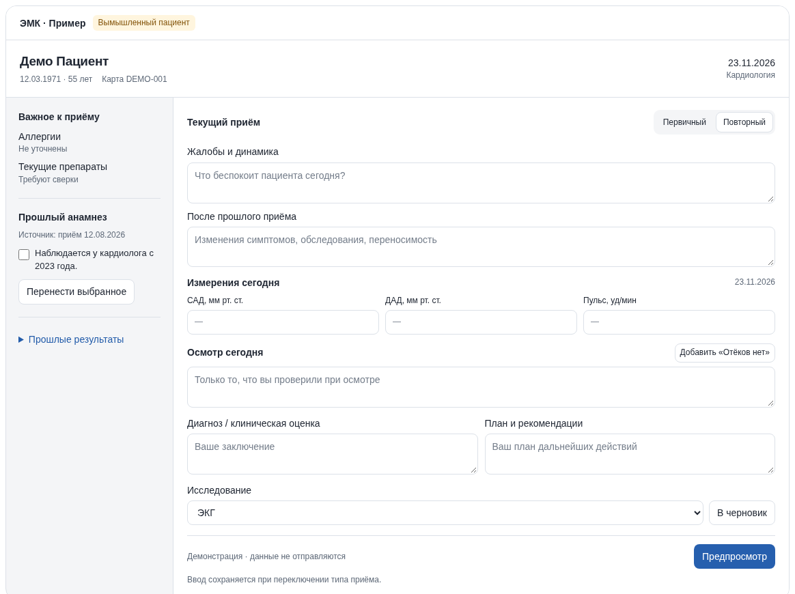
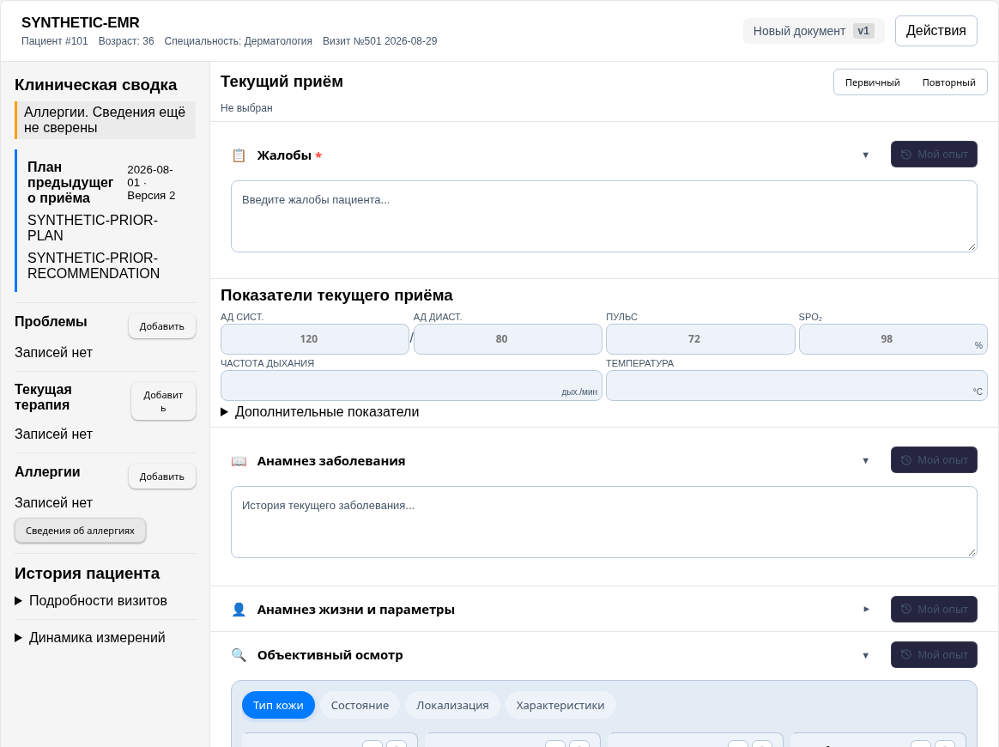

# EMR workspace visual reference

`emr-workspace-concept.html` is the original owner-supplied visual reference for the EMR workspace. It is preserved byte-for-byte; its SHA-256 is `35091e604abf172f0ae67f6b5c8e01bc2693c4c466537ef088e7e2ab1cd7f4cd`.

The reference shows a synthetic patient and these visual priorities:

- A compact patient identity header above the workspace.
- A narrow left summary for allergies, current therapy, prior history and results.
- A wide right-side editor, with the visit label and initial/follow-up controls on one row.
- Complaints near the top, compact today's measurements, and assessment and plan side by side.
- A quiet neutral surface with details available on demand.

The file is a design reference, not an executable task specification. Its embedded interactions were not run. The static reference screenshot was captured at 1164 × 870 with browser JavaScript disabled; the browser's default body margin was removed so the concept card fills the frame as in the supplied screenshot.

The live EMR retains additional fields and safety information required by the product. The alignment work changes visual placement only and keeps those fields available.

## Visual comparison

Both images below are 1164 × 870 and use synthetic data. The concept image is the static original HTML with JavaScript disabled. The PR image is a browser capture of the current EMR workspace at the same viewport, cropped to the workspace; its API responses are mocked by the existing Playwright visual test.

### Owner-supplied concept

### PR #4236 current workspace

The two screenshots show different implementations and content density. The PR retains the application's additional clinical fields and safety details. The label and visit-type selector now share one row, while the left clinical summary and wide editor follow the same broad arrangement as the concept.
